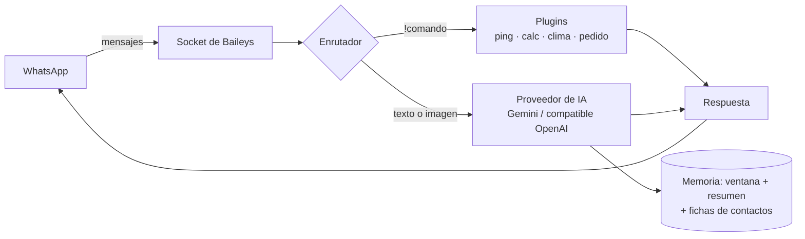

<div align="center">


**Un agente de IA self-hosted para tu WhatsApp.** Usa tu propio modelo — Google Gemini (capa gratuita), OpenAI, Groq, OpenRouter… o **Ollama para que todo corra en tu máquina**. Responde, recuerda, ejecuta comandos y entiende imágenes.

[](https://github.com/987rafa/whatsapp-ai-agent/actions/workflows/ci.yml)
[](LICENSE)
[](https://nodejs.org)
[](#contribuir)
[](README.md)

</div>

---

## ✨ ¿Por qué whatsapp-ai-agent?

- 🧠 **IA real desde $0** — funciona al instante con la capa gratuita de Google Gemini, o con cualquier endpoint compatible con OpenAI: Groq, OpenRouter, Together, LM Studio o **Ollama para que nada salga de tu máquina**.
- 🪶 **Sin relleno** — solo 3 dependencias, Node.js ≥ 22 puro, sin build, sin base de datos. ESM, test runner nativo y CI incluidos.
- 🔒 **Self-hosted = privado** — tu sesión, tus mensajes, tu máquina. No hay servidores intermediarios porque no hay intermediarios.
- 🖼️ **Entiende imágenes** — manda una foto y pídele lo que quieras: *descríbela, tradúcela, léela.*
- 🧩 **Arquitectura de plugins** — agrega un comando en ~10 líneas; `!help` se genera solo.
- 🛒 **Toma pedidos para tu negocio** — `!menu` muestra el catálogo en vivo y `!pedido 2 gaseosa, 1 pan tajado` manda el pedido directo a [NOVUS POS](https://github.com/987rafa/novus-pos).
- 🧵 **Memoria real de largo plazo** — mensajes recientes + un resumen que se actualiza solo + **ficha de cada contacto** (nombre y datos aprendidos de la conversación). `!quien` te la muestra.
- 🤖 **Modo secretario autónomo** — responde solo tus privados (como tu asistente, o en tu nombre), con pausas humanas, y 🔔 te avisa cuando algo necesita de verdad a una persona.
- ⚡ **Dos formas de vincular** — QR o **código de 8 dígitos** (`PAIRING_PHONE`), sin escanear nada.
- 🐳 **Despliegue aburrido (en el buen sentido)** — Docker, docker-compose, Render o `npm start` y ya.

## 🚀 Inicio rápido

Necesitas una cuenta de WhatsApp (ideal: un número de repuesto) y una [API key gratuita de Gemini](https://aistudio.google.com/apikey).

### Opción A — Docker (recomendada)

```bash
git clone https://github.com/987rafa/whatsapp-ai-agent.git
cd whatsapp-ai-agent
cp .env.example .env      # pega aquí tu key gratuita de Gemini
docker compose up -d --build && docker compose logs -f
```

### Opción B — Node.js

```bash
git clone https://github.com/987rafa/whatsapp-ai-agent.git
cd whatsapp-ai-agent
cp .env.example .env      # pega aquí tu key gratuita de Gemini
npm install && npm start
```

Escanea el QR de la terminal: **WhatsApp → Ajustes → Dispositivos vinculados → Vincular dispositivo**. Listo — manda `!ping` o simplemente escríbele. 🎉

> ¿Sin QR? Configura `PAIRING_PHONE=573001234567` (formato internacional, sin `+`) y el agente te dará un código de 8 dígitos.

## 💬 Así se ve

```text
Tú    ❯ !ping
Aria  ❯ 🏓 pong

Tú    ❯ resúmeme esto en 3 puntos: <texto largo>
Aria  ❯ 1) …  2) …  3) …

Tú    ❯ [foto de un menú] ¿qué es lo más saludable?
Aria  ❯ El pescado a la plancha con ensalada es tu mejor opción — ~420 kcal…

Tú    ❯ !clima Medellín
Aria  ❯ 🌦️ Medellín: ⛅️ +24°C (sensación +25°C) · 💧62% · 🌬️↘9km/h

— y mientras tanto, los privados que le llegan los responde solo: —

Juan  ❯ ¿me pasas la cotización hoy?
Aria  ❯ ¡Claro, Juan! La tenía lista — te la envío hoy mismo, ¿la prefieres en PDF?

Tú    ❯ !ia off        ← silencia la IA en este chat
Aria  ❯ 🔕 IA desactivada en este chat.
```

## 🤖 Modo secretario autónomo

Por defecto el agente trata cada **chat privado** como una conversación real: identifica quién escribe (nombre + datos que aprende de los propios mensajes), mantiene una memoria de largo plazo (ventana reciente + resumen rodante) y responde por su cuenta — sin comandos, nunca.

- **Modos** — `AUTO_REPLY_MODE=assistant` (se presenta como tu asistente) u `owner` (responde en tu nombre; y es honesto si alguien pregunta directamente si es una IA).
- **Escalado** — configura `OWNER_NOTIFY` y, cuando un mensaje necesita de verdad a una persona (dinero, legal, urgencia personal), responde con educación *y* te manda un 🔔 con lo que pasó.
- **Control** — `!ia off` silencia un chat, `AUTO_REPLY_DENY` / `AUTO_REPLY_ALLOW` filtran números, y los grupos siguen siendo solo por mención.

## 🧩 Comandos incluidos

| Comando | Qué hace |
| --- | --- |
| `!ping` | Verifica que el agente está vivo — `pong` |
| `!help` | Lista de comandos autogenerada |
| `!calc (2+3)*4^2` | Calculadora segura (parser propio, sin `eval`) |
| `!clima Bogotá` | Clima actual de cualquier ciudad |
| `!menu` | Menú del negocio con precios en vivo (catálogo de NOVUS POS) |
| `!pedido 2 gaseosa, 1 pan tajado` | Pedido del cliente directo a la cola de Pedidos del POS |
| `!ia on` / `!ia off` | Activa o silencia la IA por chat |
| `!quien` | Ficha del contacto: lo que el agente sabe de esa persona |
| `!nombre Juan` | Guarda el nombre del contacto |
| `!nota Espera cotización` | Le enseña un dato duradero del contacto |
| `!resumen` | Muestra el resumen que recuerda de la conversación |
| `!olvidar` / `!olvidar todo` | Borra la memoria (y opcionalmente la ficha del contacto) |

En **grupos**, la IA solo responde cuando la mencionan (o cuando respondes a uno de sus mensajes); si no, el grupo queda en silencio.

## ⚙️ Configuración

Todo vive en `.env` (mira [`.env.example`](.env.example)):

| Variable | Por defecto | Descripción |
| --- | --- | --- |
| `AI_PROVIDER` | `gemini` | `gemini` u `openai` (cualquier API compatible) |
| `GEMINI_API_KEY` | — | Key gratuita en [aistudio.google.com](https://aistudio.google.com/apikey) |
| `GEMINI_MODEL` | `gemini-3.5-flash-lite` | Cualquier modelo Gemini (ej. `gemini-3.8-flash`) |
| `OPENAI_API_KEY` | — | Key del proveedor compatible con OpenAI |
| `OPENAI_BASE_URL` | `https://api.openai.com/v1` | Apúntalo donde quieras (Groq, OpenRouter, Ollama…) |
| `OPENAI_MODEL` | `gpt-4o-mini` | Nombre del modelo |
| `BOT_NAME` | `Aria` | Nombre del agente en su prompt de sistema |
| `BOT_LANG` | `es` | `es` o `en` — idioma de los mensajes internos |
| `BOT_PREFIX` | `!` | Prefijo de comandos |
| `AI_PRIVATE_CHATS` | `true` | Responder a todos los privados |
| `AI_GROUP_MENTIONS` | `true` | En grupos, responder solo al ser mencionado |
| `AI_HISTORY_SIZE` | `12` | Mensajes de memoria por chat |
| `AI_SYSTEM_PROMPT` | asistente amable | La personalidad del agente |
| `AUTO_REPLY_MODE` | `assistant` | `assistant` (como tu secretario) u `owner` (en tu nombre) |
| `OWNER_NAME` | — | Tu nombre — el agente firma como tu asistente |
| `OWNER_STYLE` | natural y breve | Cómo debe escribir |
| `AUTO_REPLY_ALLOW` | — | Solo estos números reciben respuesta (separados por comas) |
| `AUTO_REPLY_DENY` | — | Nunca responder a estos números |
| `OWNER_NOTIFY` | — | Número que recibe avisos 🔔 cuando hace falta un humano |
| `MEMORY_SUMMARY_EVERY` | `16` | Mensajes entre actualizaciones de memoria en segundo plano |
| `PAIRING_PHONE` | — | Vincular con código en vez de QR |
| `POS_URL` | — | Dirección de la API de NOVUS POS (activa `!menu` / `!pedido`) |
| `POS_API_KEY` | — | La `ORDERS_API_KEY` del POS (canal de pedidos) |
| `DATA_DIR` | `./data` | Dónde vive la sesión y el store |

### 100% local con Ollama

```env
AI_PROVIDER=openai
OPENAI_BASE_URL=http://localhost:11434/v1
OPENAI_API_KEY=ollama        # cualquier texto no vacío
OPENAI_MODEL=llama3.2        # o un modelo llava para entender imágenes
```

### 🛒 Pedidos directo a [NOVUS POS](https://github.com/987rafa/novus-pos)

Apunta el agente a tu POS y tus clientes pueden ver el menú y pedir por WhatsApp:

```env
POS_URL=http://localhost:8000   # API de NOVUS POS
POS_API_KEY=pedidos-demo-key    # la ORDERS_API_KEY del POS
```

`!menu` responde con el catálogo en vivo (precios y agotados incluidos). `!pedido 2 gaseosa, 1 pan tajado` empareja los productos contra el catálogo, manda el pedido al POS (canal `whatsapp`, con nombre y número del cliente) y confirma el total. Los pedidos caen en la cola de **Pedidos** del POS, donde caja los convierte en venta o los rechaza.

## 🏗️ Cómo funciona



- `src/core/agent.js` — el enrutador: comando, IA o silencio.
- `src/core/store.js` — store JSON mínimo: memoria y ajustes por chat.
- `src/ai/` — adaptadores de proveedores (puro `fetch`, sin SDKs).
- `src/plugins/` — un archivo por comando, autodescubiertos.

## 🔌 Escribe tu propio plugin

Suelta un archivo en `src/plugins/` — esa es toda la API:

```js
// src/plugins/echo.js
export default {
  name: 'echo',
  aliases: ['repetir'],
  description: 'Repite lo que dices — ej: !echo hola',
  run: async (ctx) => ctx.args.join(' ') || 'dime algo 🙂',
};
```

`ctx` te da `sock`, `msg`, `args`, `config`, `getSetting` / `setSetting`, `clearMemory` y más. Reinicia y `!help` ya lo lista.

## ☁️ Despliegue

[](https://render.com/deploy?repo=https://github.com/987rafa/whatsapp-ai-agent)

Funciona perfecto en cualquier VPS pequeño, host Docker o una Raspberry Pi en casa. El único estado es `./data` — móntalo y olvídate.

## 🗺️ Roadmap

- [x] Auto-respuesta autónoma en privados con ficha de contactos y escalado a humano
- [x] Pedidos directo a [NOVUS POS](https://github.com/987rafa/novus-pos) — `!menu` + `!pedido`
- [ ] Tool calling: que la IA use los plugins por su cuenta
- [ ] Notas de voz → transcripción (Whisper) → respuesta
- [ ] RAG: responder desde tus propios documentos
- [ ] Fallback entre proveedores + modelo por chat
- [ ] Dashboard web (React) para memoria y ajustes

## 🤝 Contribuir

¡Los PRs son bienvenidos! Fork → rama → `npm test` → PR. Ideas y bugs: [abre un issue](https://github.com/987rafa/whatsapp-ai-agent/issues).

> ⚠️ **Aviso** — proyecto no oficial, self-hosted, construido sobre el protocolo multi-dispositivo de WhatsApp Web (vía [Baileys](https://github.com/WhiskeySockets/Baileys)). Úsalo con responsabilidad con tu propio número y no hagas spam.

## 📄 Licencia

MIT © [Rafael Álvarez · NOVUS DEV](https://github.com/987rafa)

---

<div align="center">

**Si este proyecto te ahorró tiempo, una ⭐ ayuda a que más gente lo encuentre.**

</div>
