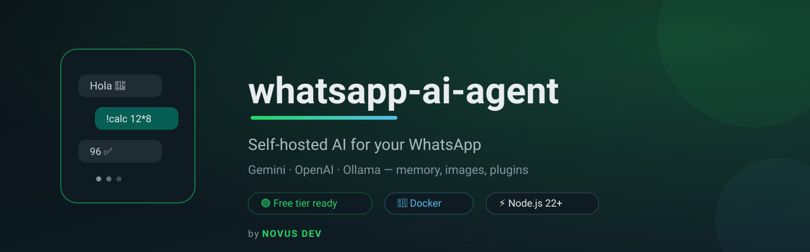
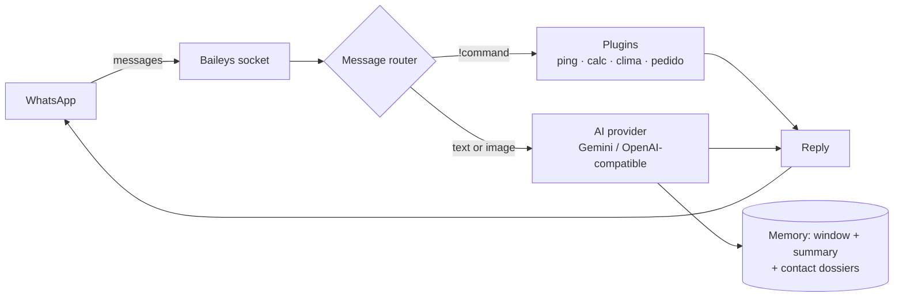

<div align="center">



**A self-hosted AI agent for your WhatsApp.** Bring your own LLM — Google Gemini (free tier), OpenAI, Groq, OpenRouter… or **Ollama for 100% local**. It replies, remembers, runs commands and understands images.

[](https://github.com/987rafa/whatsapp-ai-agent/actions/workflows/ci.yml)
[](LICENSE)
[](https://nodejs.org)
[](#contributing)
[](README.es.md)

</div>

---

## ✨ Why whatsapp-ai-agent?

- 🧠 **Real AI, $0 to start** — works out of the box with Google Gemini's free tier, or any OpenAI-compatible endpoint: Groq, OpenRouter, Together, LM Studio, or **Ollama to keep everything on your machine**.
- 🪶 **Zero bloat** — just 3 dependencies, pure Node.js ≥ 22, no build step, no database. ESM everywhere, native test runner, CI included.
- 🔒 **Self-hosted means private** — your session, your messages, your machine. There are no servers in the middle because there is no middle.
- 🖼️ **It understands images** — send a photo and ask anything: *describe it, translate it, read the text in it.*
- 🧩 **Plugin architecture** — add a command in ~10 lines; `!help` builds itself from your plugins.
- 🛒 **Takes orders for your business** — `!menu` shows your live catalog and `!pedido 2 gaseosa, 1 pan tajado` sends the order straight into [NOVUS POS](https://github.com/987rafa/novus-pos).
- 🧵 **Real long-term memory** — recent messages + a rolling summary that updates itself + a **dossier for every contact** (name and facts learned from the chat). `!quien` shows it.
- 🤖 **Autonomous secretary mode** — it answers your DMs on its own (as your assistant, or in your name), with human-like pauses, and 🔔 pings you when a message really needs a human.
- ⚡ **Two ways to link** — scan a QR or use an **8-digit pairing code** (`PAIRING_PHONE`), no QR needed.
- 🐳 **Boring deployment** — Docker, docker-compose, Render, or plain `npm start`.

## 🚀 Quick start

You need a WhatsApp account (a spare number works best) and a free [Gemini API key](https://aistudio.google.com/apikey).

### Option A — Docker (recommended)

```bash
git clone https://github.com/987rafa/whatsapp-ai-agent.git
cd whatsapp-ai-agent
cp .env.example .env      # paste your free Gemini key here
docker compose up -d --build && docker compose logs -f
```

### Option B — Node.js

```bash
git clone https://github.com/987rafa/whatsapp-ai-agent.git
cd whatsapp-ai-agent
cp .env.example .env      # paste your free Gemini key here
npm install && npm start
```

Now scan the QR shown in your terminal: **WhatsApp → Settings → Linked devices → Link a device**. That's it — send `!ping` to your own number from another account… or just message the linked phone and chat with the agent. 🎉

> Prefer no QR? Set `PAIRING_PHONE=573001234567` (international format, no `+`) and the agent prints an 8-digit code instead.

## 💬 What it looks like

```text
You  ❯ !ping
Aria ❯ 🏓 pong

You  ❯ summarize this in 3 bullets: <long text pasted>
Aria ❯ 1) …  2) …  3) …

You  ❯ [photo of a restaurant menu] what's the healthiest option?
Aria ❯ The grilled fish with salad is your best bet — about 420 kcal…

You  ❯ !clima Medellín
Aria ❯ 🌦️ Medellín: ⛅️ +24°C (sensación +25°C) · 💧62% · 🌬️↘9km/h

— and meanwhile, the DMs your contacts send are answered all by itself: —

Juan ❯ ¿me pasas la cotización hoy?
Aria ❯ ¡Claro, Juan! La tenía lista — te la envío hoy mismo, ¿la prefieres en PDF?

You  ❯ !ia off        ← mute the AI in this chat
Aria ❯ 🔕 IA desactivada en este chat.
```

## 🤖 Autonomous secretary mode

By default the agent treats every **private chat** as a real conversation: it identifies who is writing (name + facts it learns from the messages themselves), keeps a long-term memory (recent window + rolling summary) and replies on its own — no commands needed, ever.

- **Modes** — `AUTO_REPLY_MODE=assistant` (introduces itself as your secretary) or `owner` (replies in your name; and stays honest if someone asks point-blank whether it's an AI).
- **Escalation** — set `OWNER_NOTIFY` and, when a message truly needs a human (money, legal, personal urgency), it answers politely *and* sends you a 🔔 summary of what happened.
- **Control** — `!ia off` mutes a chat, `AUTO_REPLY_DENY` / `AUTO_REPLY_ALLOW` filter numbers, and groups stay mention-only.

## 🧩 Built-in commands

| Command | What it does |
| --- | --- |
| `!ping` | Liveness check — `pong` |
| `!help` | Auto-generated command list |
| `!calc (2+3)*4^2` | Safe calculator (own parser, no `eval`) |
| `!clima Bogotá` | Current weather for any city |
| `!menu` | Business menu with live prices (NOVUS POS catalog) |
| `!pedido 2 gaseosa, 1 pan tajado` | Customer order straight into the POS orders queue |
| `!ia on` / `!ia off` | Enable or mute the AI per chat |
| `!quien` | Contact dossier: what the agent knows about this person |
| `!nombre Juan` | Save this contact's name |
| `!nota Espera cotización` | Teach it a durable fact about the contact |
| `!resumen` | Show the conversation summary it remembers |
| `!olvidar` / `!olvidar todo` | Wipe memory (and optionally the contact dossier) |

In **groups** the AI only answers when it's mentioned (or when you reply to one of its messages) — groups stay quiet otherwise.

## ⚙️ Configuration

Everything lives in `.env` (see [`.env.example`](.env.example)):

| Variable | Default | Description |
| --- | --- | --- |
| `AI_PROVIDER` | `gemini` | `gemini` or `openai` (any OpenAI-compatible API) |
| `GEMINI_API_KEY` | — | Free key at [aistudio.google.com](https://aistudio.google.com/apikey) |
| `GEMINI_MODEL` | `gemini-3.5-flash-lite` | Any Gemini model (e.g. `gemini-3.8-flash`) |
| `OPENAI_API_KEY` | — | Key for OpenAI-compatible providers |
| `OPENAI_BASE_URL` | `https://api.openai.com/v1` | Point it anywhere (Groq, OpenRouter, Ollama…) |
| `OPENAI_MODEL` | `gpt-4o-mini` | Model name for the compatible provider |
| `BOT_NAME` | `Aria` | The agent's name in its system prompt |
| `BOT_LANG` | `es` | `es` or `en` — language of built-in messages |
| `BOT_PREFIX` | `!` | Command prefix |
| `AI_PRIVATE_CHATS` | `true` | Reply to every DM |
| `AI_GROUP_MENTIONS` | `true` | In groups, reply only when mentioned |
| `AI_HISTORY_SIZE` | `12` | Messages of memory per chat |
| `AI_SYSTEM_PROMPT` | friendly assistant | The agent's personality |
| `AUTO_REPLY_MODE` | `assistant` | `assistant` (as your secretary) or `owner` (in your name) |
| `OWNER_NAME` | — | Your name — the agent signs as your assistant |
| `OWNER_STYLE` | natural & brief | How it should write |
| `AUTO_REPLY_ALLOW` | — | Only these numbers get replies (comma separated) |
| `AUTO_REPLY_DENY` | — | Never reply to these numbers |
| `OWNER_NOTIFY` | — | Number that receives 🔔 alerts when a human is needed |
| `MEMORY_SUMMARY_EVERY` | `16` | Messages between background memory updates |
| `PAIRING_PHONE` | — | Link with a code instead of QR |
| `POS_URL` | — | NOVUS POS API address (enables `!menu` / `!pedido`) |
| `POS_API_KEY` | — | The POS `ORDERS_API_KEY` (orders channel) |
| `DATA_DIR` | `./data` | Where session + store are kept |

### 100% local with Ollama

```env
AI_PROVIDER=openai
OPENAI_BASE_URL=http://localhost:11434/v1
OPENAI_API_KEY=ollama        # any non-empty string
OPENAI_MODEL=llama3.2        # or an llava model for image understanding
```

### 🛒 Orders straight into [NOVUS POS](https://github.com/987rafa/novus-pos)

Point the agent at your POS and customers can browse the menu and order inside WhatsApp:

```env
POS_URL=http://localhost:8000   # NOVUS POS API
POS_API_KEY=pedidos-demo-key    # the POS ORDERS_API_KEY
```

`!menu` replies with the live catalog (prices and out-of-stock included). `!pedido 2 gaseosa, 1 pan tajado` matches the items against the catalog, sends the order to the POS (channel `whatsapp`, with the customer's name and number) and confirms the total. Orders land in the POS **Pedidos** queue, where the cashier confirms them into a sale or rejects them.

## 🏗️ How it works



- `src/core/agent.js` — the router: command, AI, or silence.
- `src/core/store.js` — tiny JSON store: per-chat memory & settings.
- `src/ai/` — provider adapters (plain `fetch`, no SDKs).
- `src/plugins/` — one file per command, auto-discovered.

## 🔌 Write your own plugin

Drop a file in `src/plugins/` — that's the whole API:

```js
// src/plugins/echo.js
export default {
  name: 'echo',
  aliases: ['repetir'],
  description: 'Repeats what you say — e.g. !echo hola',
  run: async (ctx) => ctx.args.join(' ') || 'say something 🙂',
};
```

`ctx` gives you `sock`, `msg`, `args`, `config`, `getSetting` / `setSetting`, `clearMemory` and more. Restart, and `!help` already lists it.

## ☁️ Deploy

[](https://render.com/deploy?repo=https://github.com/987rafa/whatsapp-ai-agent)

Works great on any small VPS, Docker host, or a Raspberry Pi left at home. The only state is `./data` — mount it and forget it.

## 🗺️ Roadmap

- [x] Autonomous DM replies with contact dossiers and human escalation
- [x] Orders straight into [NOVUS POS](https://github.com/987rafa/novus-pos) — `!menu` + `!pedido`
- [ ] Tool/function calling (let the AI use the built-in commands itself)
- [ ] Voice notes → transcription (Whisper) → reply
- [ ] RAG: answer questions from your own documents
- [ ] Multi-provider fallback + per-chat model selection
- [ ] Web dashboard (React) for memory & settings

## 🤝 Contributing

PRs are welcome! Fork → branch → `npm test` → PR. Ideas and bugs: [open an issue](https://github.com/987rafa/whatsapp-ai-agent/issues).

> ⚠️ **Disclaimer** — this is an unofficial, self-hosted project built on the WhatsApp Web multi-device protocol (via [Baileys](https://github.com/WhiskeySockets/Baileys)). Use it responsibly with your own number, and don't spam.

## 📄 License

MIT © [Rafael Álvarez · NOVUS DEV](https://github.com/987rafa)

---

<div align="center">

**If this project saved you time, a ⭐ helps more people find it.**

</div>
